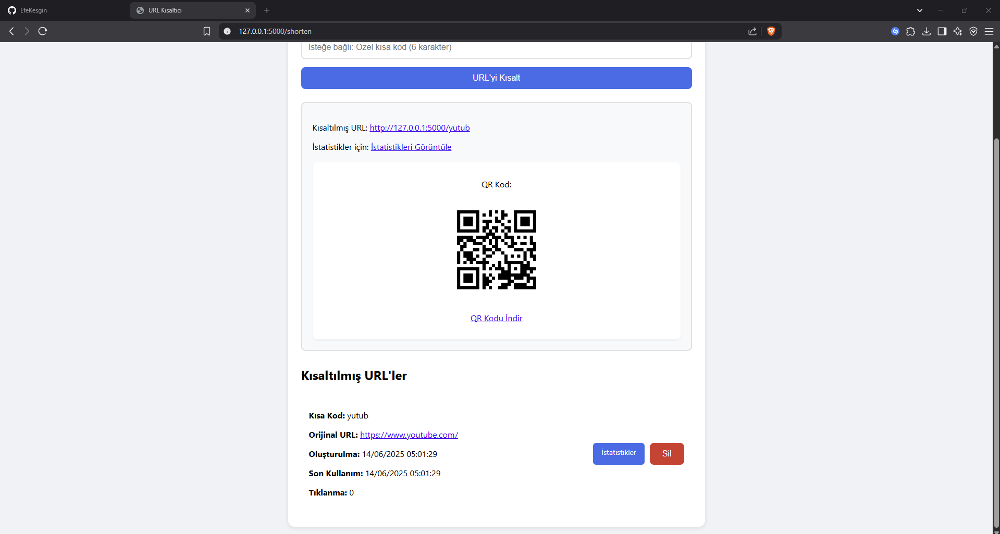
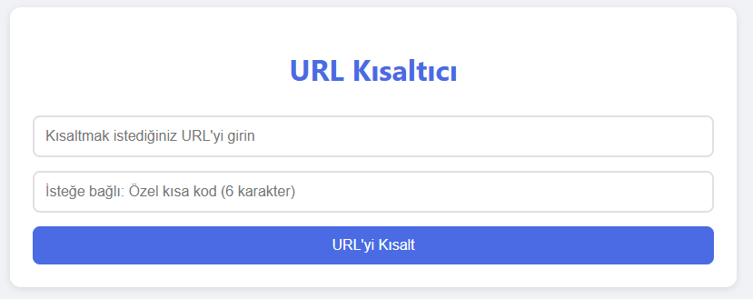
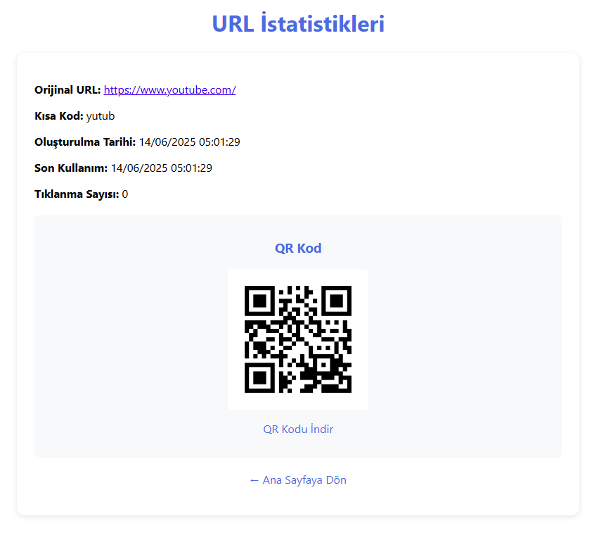

<div align="center">

# URL Kısaltıcı

**Uzun bağlantıları kısa ve akılda kalan adreslere çeviren, QR kod üreten ve tıklanmaları sayan küçük bir web uygulaması.**
Kendi bilgisayarında çalışır; hesap, reklam veya üçüncü taraf servis yok.


[](LICENSE)

</div>



## Neler yapabilir?

| | |
| --- | --- |
| **Kısaltma** | Uzun URL'yi rastgele 6 karakterlik bir koda çevirir (ör. `localhost:5000/aB3xY9`). |
| **Özel kod** | İstersen kodu kendin seç (en fazla 6 harf/rakam). |
| **QR kod** | Her kısa bağlantı için QR kod; tek tıkla PNG olarak indir. |
| **İstatistik** | Tıklanma sayısı, oluşturulma ve son kullanım tarihi. |
| **Yönetim** | Tüm kısaltılmış bağlantıları tek listede gör, istemediğini sil. |
| **Güvenli** | Yalnızca `http` / `https` bağlantıları kabul edilir; `javascript:` gibi zararlı adresler reddedilir. |

<table>
  <tr>
    <td></td>
    <td></td>
  </tr>
  <tr>
    <td align="center"><sub>Bağlantı kısaltma ve liste</sub></td>
    <td align="center"><sub>İstatistik ve QR kod</sub></td>
  </tr>
</table>

## Hızlı başlangıç

```bash
git clone https://github.com/EfeKesgin/url-kisaltici.git
cd url-kisaltici
pip install -r requirements.txt
python app.py
```

Tarayıcında **http://localhost:5000** adresini aç, URL'yi yapıştır ve **URL'yi Kısalt**'a tıkla.

> Kısaltılan bağlantılar proje klasöründeki `urls.json` dosyasında tutulur. Dosya ilk
> kısaltmada kendiliğinden oluşur ve depoya eklenmez.

## English

**URL Kısaltıcı** is a small Flask web app that turns long links into short codes, with optional
custom codes, QR code generation and download, click statistics and link management. It runs
locally and stores data in a JSON file. Only `http`/`https` URLs are accepted. The interface is
in Turkish.

---

## Geliştiriciler için

### Uç noktalar

| Yol | Yöntem | İşlev |
| --- | --- | --- |
| `/` | GET | Ana sayfa ve bağlantı listesi |
| `/shorten` | POST | `url` ve isteğe bağlı `custom_code` ile kısaltma |
| `/<kod>` | GET | Asıl adrese yönlendirir, tıklanmayı sayar |
| `/stats/<kod>` | GET | İstatistik sayfası |
| `/qr/<kod>` | GET | QR kod (PNG) |
| `/qr/<kod>/download` | GET | QR kodu dosya olarak indirir |
| `/delete/<kod>` | POST | Bağlantıyı siler |

`shorten`, `stats`, `qr` ve `delete` uygulamanın kendi yolları olduğu için özel kod olarak kullanılamaz.

### Ayarlar

- **Hata ayıklama modu** varsayılan olarak kapalıdır. Geliştirirken açmak için:
  `FLASK_DEBUG=1 python app.py` (PowerShell: `$env:FLASK_DEBUG=1; python app.py`).
- Uygulamada kullanıcı girişi yoktur; herkese açık bir sunucuda çalıştıracaksan silme ve
  listeleme sayfalarını bir kimlik doğrulamanın arkasına al.

### Teknolojiler

Python, Flask, [qrcode](https://github.com/lincolnloop/python-qrcode) (Pillow ile), HTML/CSS.

## Lisans

URL Kısaltıcı [MIT Lisansı](LICENSE) ile dağıtılır.
